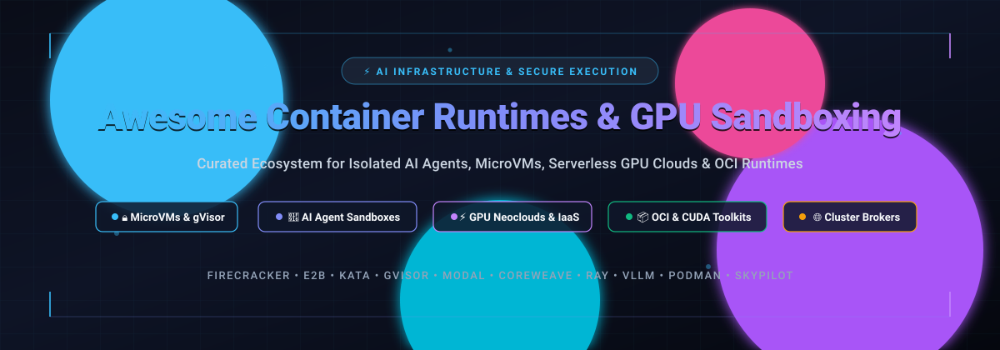

# 🚀 Awesome Container Runtimes & GPU Cloud Sandboxing

  
  
  
  
  
  

  <strong>Curated Directory of Open-Source Container Runtimes, Isolated AI Agent Sandboxes, MicroVMs, Serverless GPU Clouds, vGPU Virtualization &amp; Distributed LLM Cluster Orchestration</strong>

  <em>Updated regularly for AI infrastructure engineers, platform architects, MLOps specialists, and security researchers.</em>

---

## 📑 Table of Contents

- [🌐 Sector Overview & Market Dynamics](#-sector-overview--market-dynamics)
- [☁️ SaaS & Hosted GPU Cloud Platforms](#️-saas--hosted-gpu-cloud-platforms)
- [📦 Open-Source GitHub Projects](#-open-source-github-projects)
  - [🔥 AI Agent Sandboxing, MicroVMs & Isolation Kernels](#-ai-agent-sandboxing-microvms--isolation-kernels)
  - [⚡ High-Performance LLM Serving & GPU Container Runtimes](#-high-performance-llm-serving--gpu-container-runtimes)
  - [🛠️ OCI Standard, Low-Level Runtimes & Container Toolkits](#️-oci-standard-low-level-runtimes--container-toolkits)
  - [🌐 Distributed AI Cluster Schedulers & Compute Brokers](#-distributed-ai-cluster-schedulers--compute-brokers)
  - [🎮 GPU Virtualization, vGPU Sharing & Cloud Operators](#-gpu-virtualization-vgpu-sharing--cloud-operators)
- [🤝 How to Contribute](#-how-to-contribute)
- [💖 Support & Sponsorship](#-support--sponsorship)
- [📈 Star History](#-star-history)
- [⚠️ Disclaimer](#️-disclaimer)

---

## 🌐 Sector Overview & Market Dynamics

The global GPU-as-a-Service (GPUaaS) and GPU Cloud infrastructure sector is estimated at **$43.6B to $50B+ in 2026** (growing at a 20–30%+ CAGR), transitioning heavily from exploratory training clusters to continuous, production-grade AI agent sandboxes and low-latency inference workloads. The sector exhibits a **moderately fragmented, multi-tiered structure**: top-tier hyperscalers (AWS, Azure, GCP, OCI) command foundational enterprise spend (>60%), while high-growth specialized "neoclouds" (CoreWeave, Crusoe, Lambda, Modal) capture massive market share on price-performance, bare-metal InfiniBand fabrics, and developer ergonomics, flanked by peer-to-peer/decentralized marketplaces (Vast.ai) addressing cost-sensitive spot execution.

---

## ☁️ SaaS & Hosted GPU Cloud Platforms

| Platform | Company Valuation / Revenue Scale | Starting Pricing | Free Tier / Trial Limits | Key Capabilities & Architecture |
| :--- | :--- | :--- | :--- | :--- |
| **[Crusoe Cloud](https://crusoe.ai)** | **$30.9B Valuation** (~$2B ARR) | ~$2.00/hr (On-demand GPU instances; H100 SXM ~$2.30–$3.00/hr) | **No Free Tier / No Free Trial** (Enterprise evaluation credits issued selectively via sales team) | Climate-aligned high-density GPU infrastructure powered by stranded/clean energy; managed Kubernetes, Slurm, and InfiniBand networking. |
| **[CoreWeave](https://coreweave.com)** | **$27B–$28B Market Cap** (~$13B ARR guidance) | ~$1.28/hr (RTX A6000; H100 SXM5 ~$2.06/hr, A100 80GB ~$2.21/hr) | **CoreWeave Forge Free Plan** ($0/mo for experiment tracking & model evaluation); $50 one-time developer credits on signup; no free GPU hours. | Specialized bare-metal Kubernetes GPU cloud with InfiniBand fabrics; zero egress fees and high-performance NVMe/object storage. |
| **[FluidStack](https://fluidstack.io)** | **$18B Valuation** (~$660M ARR) | ~$1.50/hr (Starting on-demand GPU rate; H100 ~$1.50–$2.30/hr) | **No Free Tier / No Free Trial** (Enterprise contracts and custom deployments only; no public self-service tier) | High-speed bare-metal and containerized GPU cloud clusters tailored for LLM training labs, custom data centers, and multi-cloud brokers. |
| **[Modal](https://modal.com)** | **$15.75B Valuation** (~$1B ARR) | $0.00/mo base + $0.00005/core-sec CPU, ~$0.00016/sec (T4 ~$0.59/hr, A100 80GB ~$3.40/hr) | **Permanent Free Starter Tier**: $30/month recurring free compute credits, 3 seats, 100 max containers, 10 GPU concurrency limit, 1 TiB/month egress. | Serverless cloud compute and sub-second container sandboxing; Python-native GPU scheduling for isolated AI agent execution and inference. |
| **[Lambda Labs](https://lambdalabs.com)** | **$14.5B Valuation** (~$1.5B ARR) | ~$0.79/hr (A10; H100 SXM ~$2.49–$2.99/hr billed per minute) | **No Free Tier / No Free Trial** (Paid accounts only with credit card validation; zero developer trial credits) | Developer-centric AI cloud with 1-Click Clusters, pre-configured ML container runtimes, zero egress charges, and on-demand H100/B200 nodes. |
| **[Together AI](https://together.ai)** | **$8.3B Valuation** | ~$0.14 per 1M tokens (Serverless inference) / ~$3.99/hr (Dedicated H100 GPU clusters) | **No Free Tier** ($15 minimum initial prepaid deposit required; Startup grant program offers $15K–$50K credits upon application) | Unified AI acceleration platform pairing serverless model endpoints, dedicated GPU clusters, and isolated Python code interpreter sandboxes. |
| **[Anyscale](https://anyscale.com)** | **$1.65B Valuation** (Acquired by Nscale; ~$100M ARR) | ~$0.0135/hr (CPU instances), ~$0.57/hr (T4 GPU), ~$4.96/hr (A100 GPU) | **Permanent Free Account Tier** with community support + **$100 one-time free trial credits** for new developer signups. | Managed Ray compute platform for scalable distributed AI workloads, multi-node GPU clusters, and serverless Ray Serve endpoints. |
| **[RunPod](https://runpod.io)** | **$1.0B Valuation** (~$240M ARR) | ~$0.16/hr (Community Cloud RTX A5000), ~$0.34/hr (RTX 4090), Secure Cloud H100 from ~$2.69/hr | **No Free Tier / No Free Trial** (Requires pre-funded account balance; per-second billing with zero egress fees) | Globally distributed container pods, serverless GPU workers, and custom Docker template deployments across community and secure data centers. |
| **[JarvisLabs.ai](https://jarvislabs.ai)** | **~$1.2M ARR** (Private / Bootstrapped) | ~$0.44/hr (NVIDIA L4), ~$1.49/hr (A100 80GB), H100 from ~$2.69/hr | **No Free Tier / No Free Trial** ($5 minimum wallet balance top-up required to launch; pause/resume storage at ~$0.005/GB/day) | Instant Jupyter/VS Code GPU containers, pause-and-resume persistent storage, spot instances (up to 56% off), and lightweight Python SDK. |
| **[Vast.ai](https://vast.ai)** | **Early-Stage Venture Backed** (~$4M funding) | ~$0.20/hr (Starting RTX 3080/4090 spot rates; H100 from ~$0.90–$2.40/hr) | **No Free Tier / No Free Trial** (Prepaid deposit required before instance startup; unallocated balance refundable) | Decentralized peer-to-peer GPU marketplace providing low-cost Docker container execution with real-time bidding, spot pricing, and search filters. |

---

## 📦 Open-Source GitHub Projects

All open-source repositories below are sorted by GitHub Star count in descending order. Each project includes a live Star badge linking directly to its stargazer community.

### 🌟 Ranked Open-Source Projects (by GitHub Stars)

1. **[Ollama (`ollama/ollama`)](https://github.com/ollama/ollama)**   
   🚀 Lightweight, highly optimized local LLM runner and containerized server packaging model weights, configurations, and GPU runtime into single Modelfiles.

2. **[vLLM (`vllm-project/vllm`)](https://github.com/vllm-project/vllm)**   
   ⚡ High-throughput, memory-efficient LLM serving engine featuring PagedAttention, continuous batching, chunked prefill, and native CUDA/ROCm kernel optimization.

3. **[Daytona (`daytonaio/daytona`)](https://github.com/daytonaio/daytona)**   
   🛡️ Open-source infrastructure and elastic sandbox manager for executing untrusted AI-generated code, agent workflows, and isolated development environments in milliseconds.

4. **[Ray (`ray-project/ray`)](https://github.com)**   
   🌐 Unified compute engine for scaling Python and AI workloads across multi-node GPU clusters with distributed actor scheduling and Ray Serve.

5. **[Firecracker (`firecracker-microvm/firecracker`)](https://github.com/firecracker-microvm/firecracker)**   
   🔒 Minimalist, high-security open-source Virtual Machine Monitor (VMM) written in Rust by AWS for launching isolated multi-tenant microVMs in milliseconds.

6. **[Podman (`containers/podman`)](https://github.com/containers/podman)**   
   📦 Daemonless, unprivileged container engine for developing, managing, and running OCI containers, pods, and rootless GPU workloads.

7. **[OpenShell (`ai-openshell/openshell`)](https://github.com/ai-openshell/openshell)**   
   🤖 Safe, private runtime environment engineered for isolating autonomous AI agents, shell execution, and GPU-accelerated developer workflows.

8. **[containerd (`containerd/containerd`)](https://github.com/containerd/containerd)**   
   ⚙️ Industry-standard CNCF core container runtime managing complete container lifecycles, image transfers, and execution across Kubernetes clusters worldwide.

9. **[gVisor (`google/gvisor`)](https://github.com/google/gvisor)**   
   🛡️ Application kernel written in Go (`runsc`) that intercepts container syscalls in user space to provide strong VM-like defense-in-depth isolation with NVIDIA GPU passthrough.

10. **[Wasmtime (`bytecodealliance/wasmtime`)](https://github.com/bytecodealliance/wasmtime)**   
    ⚡ Fast, secure, and standards-compliant standalone WebAssembly runtime ideal for deterministic, low-overhead AI micro-sandboxes.

11. **[E2B (`e2b-dev/E2B`)](https://github.com/e2b-dev/E2B)**   
    🤖 Secure cloud microVM runtime powered by Firecracker tailored specifically for executing untrusted AI agent code, sandboxed browsers, and stateful code interpreter sessions.

12. **[runc (`opencontainers/runc`)](https://github.com/opencontainers/runc)**   
    🔧 Foundational CLI tool and universal standard for spawning and running containers according to OCI specifications.

13. **[Triton Inference Server (`triton-inference-server/server`)](https://github.com/triton-inference-server/server)**   
    🚀 Enterprise-grade multi-framework AI inference server supporting GPUs, CPUs, concurrent model execution, dynamic batching, and model pipelining.

14. **[SkyPilot (`skypilot-org/skypilot`)](https://github.com/skypilot-org/skypilot)**   
    🛰️ Multi-cloud broker framework for executing AI jobs and GPU containers across AWS, GCP, Azure, Lambda, RunPod, and Vast.ai with automatic cost optimization and spot recovery.

15. **[WasmEdge (`WasmEdge/WasmEdge`)](https://github.com/WasmEdge/WasmEdge)**   
    ⚡ Cloud-native, high-performance WebAssembly runtime optimized for microservices, edge computing, and GPU-accelerated serverless AI inference.

16. **[Kata Containers (`kata-containers/kata-containers`)](https://github.com/kata-containers/kata-containers)**   
    🔒 Hardware-isolated OCI container runtime executing containers within lightweight virtual machines (QEMU, Cloud Hypervisor) with PCIe GPU passthrough support.

17. **[Microsandbox (`superradcompany/microsandbox`)](https://github.com/superradcompany/microsandbox)**   
    🧱 Easy, fast, programmable, and local-first microVM runtime engineered for running untrusted AI agent code on developer workstations.

18. **[Youki (`youki-dev/youki`)](https://github.com/youki-dev/youki)**   
    🦀 Fast and secure low-level OCI container runtime implemented entirely in Rust with modern Linux cgroup v2 support.

19. **[Cloud Hypervisor (`cloud-hypervisor/cloud-hypervisor`)](https://github.com/cloud-hypervisor/cloud-hypervisor)**   
    🖥️ Modern, secure Rust-based Virtual Machine Monitor tailored for cloud-native workloads, minimal attack surfaces, and VFIO device passthrough.

20. **[CRI-O (`cri-o/cri-o`)](https://github.com/cri-o/cri-o)**   
    ☸️ Lightweight, OCI-based implementation of the Kubernetes Container Runtime Interface (CRI) streamlined for production enterprise Kubernetes.

21. **[HAMi (`Project-HAMi/HAMi`)](https://github.com/Project-HAMi/HAMi)**   
    🎮 Heterogeneous GPU sharing and virtualization framework for Kubernetes enabling hard memory limits and fractional vGPU partitioning across multi-vendor GPUs.

22. **[NVIDIA Container Toolkit (`NVIDIA/nvidia-container-toolkit`)](https://github.com/NVIDIA/nvidia-container-toolkit)**   
    🔧 Universal toolkit enabling Docker, `containerd`, `CRI-O`, and Podman to automatically bind NVIDIA GPUs, CUDA libraries, and CDI specs inside containers.

23. **[Sysbox (`nestybox/sysbox`)](https://github.com/nestybox/sysbox)**   
    📦 Next-generation enhanced `runc` container runtime enabling unprivileged rootless containers to run systemd, Docker, and Kubernetes seamlessly.

24. **[Kueue (`kubernetes-sigs/kueue`)](https://github.com/kubernetes-sigs/kueue)**   
    🚦 Kubernetes-native job queueing and capacity management controller for scheduling batch ML training, GPU quotas, and fair-sharing.

25. **[NVIDIA GPU Operator (`NVIDIA/gpu-operator`)](https://github.com/NVIDIA/gpu-operator)**   
    ⚙️ Kubernetes operator automating the full lifecycle management of NVIDIA GPU drivers, container runtimes, monitoring exporters, and MIG device configurations.

26. **[dstack (`dstackai/dstack`)](https://github.com/dstackai/dstack)**   
    🚀 Unified orchestration layer for managing heterogeneous AI compute, training jobs, dev environments, and model serving across any GPU cloud or on-prem cluster.

27. **[Apptainer (`apptainer/apptainer`)](https://github.com/apptainer/apptainer)**   
    🧪 Rootless, unprivileged application container platform purpose-built for High-Performance Computing (HPC), academic GPU clusters, and reproducible research.

28. **[KubeAI (`kubeai-project/kubeai`)](https://github.com/kubeai-project/kubeai)**   
    🤖 Kubernetes-native AI inference operator providing autoscaling from zero, multi-engine support (vLLM, Ollama), and automated GPU hardware allocation.

---

## 🤝 How to Contribute

We welcome contributions from the community! To suggest a new open-source runtime, microVM project, or GPU cloud platform:

1. **Fork this repository** to your personal GitHub account.
2. **Add or update an entry** in `README.md` keeping alphabetical or star-ranked consistency.
3. **Include essential details**: Project/platform name, official link, star badge, accurate pricing/free-tier specifics, and a crisp 1–2 sentence architectural description.
4. **Submit a Pull Request** with a clear explanation of why the addition is valuable to the ecosystem.

---

## 💖 Support & Sponsorship

Thank you so much for exploring and using this curated ecosystem guide! If you find this directory valuable for your research, team, or projects, please consider supporting the project:

- ⭐ **Star this repository** to help fellow AI engineers and researchers discover it.
- 🍴 **Fork & Share** the repo with your network on LinkedIn, X/Twitter, Reddit, and developer Discord servers.
- ☕ **Buy me a coffee / Sponsor**: Support ongoing maintenance, automated tools, and open-source updates on the [GitHub Sponsor Dashboard](https://github.com/sponsors/ishandutta2007) — featuring perks including README shoutouts, sponsorship badges, and prioritized issue reviews!

---

## 📈 Star History

---

## ⚠️ Disclaimer

- This is an **independent, community-curated resource** for educational, engineering, and architectural evaluation purposes.
- Standard OCI containers (`runc`) share the host Linux kernel; when executing untrusted AI-generated code, prompt-injected LLM outputs, or multi-tenant code, always deploy hardware microVMs (`Firecracker`, `Kata Containers`, `E2B`) or syscall-intercepting kernels (`gVisor`) with strictly enforced network egress barriers.
- GPU cloud workloads and multi-node clusters incur rapid compute charges; configure automated idle shutdowns, spot-instance failovers, and VRAM/disk quotas to manage cloud spend.

---

  <strong>Crafted for AI Infrastructure Engineers, MLOps Architects, Platform Teams & Security Researchers.</strong> 
  <em>Let's build secure, fast, and isolated GPU container runtimes together.</em>

